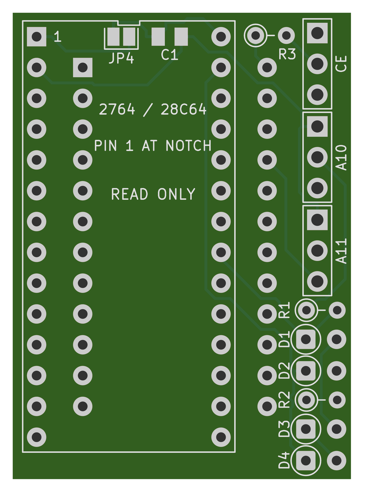
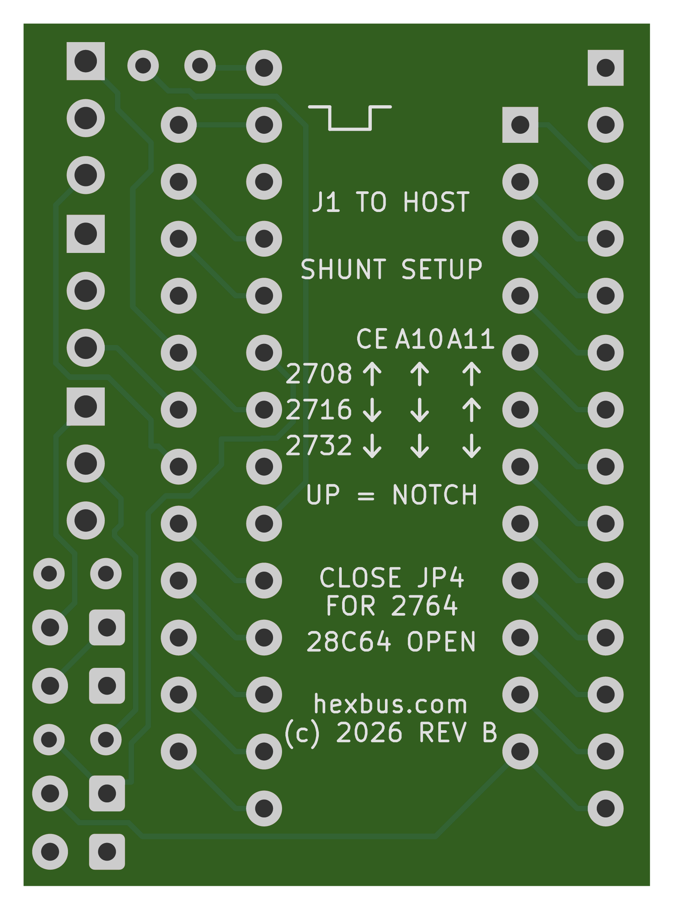

# 2708 / 2716 / 2732 to 2764 adapter

A **28 × 38.5 mm** read-only adapter for Intel-pinout 2708, 2716 and 2732 sockets. It takes a 5 V DIP-28 2764/27C64 EPROM or Microchip AT28C64B EEPROM. The three host shunts sit beside the memory and remain accessible with it installed. The notched top outline marks all 28 memory pads.

Program the replacement chip separately. Place the original image at offset **0x0000** in the 8 KiB image for the replacement. The rest can be filled with `FF`.

Check the host's +5 V current budget, especially in a 2708 socket. The Intel 2708 datasheet specifies up to 10 mA from +5 V. An Intel NMOS 2764 can draw up to 105 mA from that rail with VPP tied to VCC. Allow for the replacement's specified read current and the adapter's pull-up. [Intel 2708 DC characteristics](https://deramp.com/downloads/mfe_archive/050-Component%20Specifications/Intel/Memory%20Components/Intel%202708.pdf) · [Intel 2764 DC characteristics](https://deramp.com/downloads/mfe_archive/050-Component%20Specifications/Intel/Memory%20Components/Intel%202764.pdf)

| Host socket | JP1 CE | JP2 A10 | JP3 A11 | Bytes visible |
| --- | --- | --- | --- | --- |
| 2708 | 1–2 | 1–2 | 1–2 | `0000–03FF` (1 KiB) |
| 2716 | 2–3 | 2–3 | 1–2 | `0000–07FF` (2 KiB) |
| 2732 / 2732A | 2–3 | 2–3 | 2–3 | `0000–0FFF` (4 KiB) |

On the top, with the EPROM notch up, the shunts are labeled CE, A10 and A11 from top to bottom. The square pad on each is pin 1, nearest the notch end. Use one shunt per header. Set the shunts with power off and verify the host socket pinout before inserting the adapter. The three-supply TI TMS2716 and the TMS2532 have different pinouts.

Each host shunt header has its own outline on the top. Read the underside chart with its notch marker up. **↑** means place the shunt toward the notch (pins 1–2). **↓** means place it away from the notch (pins 2–3).

Bridge **JP4** for a 2764/27C64 that requires +5 V on VPP during reads. Leave it open for the AT28C64B, which has NC on pin 1. The socket is for normal reads only. Programming voltages on the host's control pins are outside the design limits.

## Wiring

| Signal | 24-pin host J1 | 28-pin memory U1 |
| --- | --- | --- |
| A7 through A0 | 1–8 | 3–10 |
| D0 through D2 | 9–11 | 11–13 |
| GND | 12 | 14 and A12 on pin 2 |
| D3 through D7 | 13–17 | 15–19 |
| /CE | 20 in 2708 mode, 18 otherwise | 20, with a 10 kΩ pull-up |
| A10 | GND in 2708 mode, 19 otherwise | 21, through R1 |
| /OE | 20 in all modes | 22 |
| A11 | 21 in 2732 mode, GND otherwise | 23, through R2 |
| A9 and A8 | 22 and 23 | 24 and 25 |
| +5 V | 24 | 28 and pin 27 (/PGM or /WE) |
| VPP | JP4, from +5 V | 1 |
| NC | — | 26 |

In 2708 mode, host pin 20 controls both /CE and /OE. When the host pulls that pin low, the replacement drives the data bus. When the pin goes high, the replacement releases the bus. A10, A11 and A12 are held low, so the host's ten address lines select the first 1 KiB.

The 2708 shunt settings isolate host pins 18, 19 (+12 V) and 21 (−5 V) from the memory. R1 with D1/D2 clamps A10. R2 with D3/D4 clamps A11. The resistors limit current if a misplaced shunt connects an address input to one of those rails while the adapter is powered. Set the correct host mode for the enable signals as well.

R1–R3 are upright DIN0204 resistors. D1–D4 are upright BAT85 Schottky diodes. On each diode, put the banded cathode lead in the rounded square pad inside the printed circle. C1 is a low-profile 0805 under the memory footprint. [Vishay MRS16 dimensions](https://www.vishay.com/docs/28724/mrs16m25.pdf) · [Philips BAT85 datasheet](https://media.digikey.com/pdf/Data%20Sheets/Philips%20Semiconductor%20PDFs/BAT85.pdf)

## Files and fabrication

- **[Download the Gerber ZIP — Rev B with through-hole diodes](https://github.com/hexbus/2708-16-32-to-2764-adapter/raw/refs/heads/main/gerbers/2708-16-32-to-2764-adapter-rev-b-through-hole.zip)**
- **[Order at JLCPCB using my referral link](https://jlcpcb.com/?from=RVDYTTLKZHK)**
- [KiCad project](hardware/2708-16-32-to-2764-adapter.kicad_pro), [schematic](hardware/2708-16-32-to-2764-adapter.kicad_sch) and [BOM](hardware/bom.csv)
- Original adapter layout and credit carried forward from [hexbus/2364-adapter](https://github.com/hexbus/2364-adapter). See [LICENSE](LICENSE).

Download the Gerber ZIP, open JLCPCB through the referral link, and upload
the ZIP manually. Select **2 layers, 1.6 mm FR4 and 1 oz copper**, and confirm
the detected board size is **28 × 38.5 mm** before ordering. I may receive
referral rewards for qualifying new users.

| Top | Bottom, viewed from underneath |
| --- | --- |
|  |  |

The exact ZIP was checked for copper connectivity, all three shunt settings, the 28 × 38.5 mm outline, plated drill sizes and locations, all solderable pad openings and silkscreen clearance. The previews come from the ZIP. Physical fit, soldering, bus timing and operation still need a prototype test.

For a first test, check socket fit, diode polarity and +5 V at U1 pin 28 before installing the memory. With a known image programmed at offset zero, read back the full 1 KiB, 2 KiB or 4 KiB window in the matching host mode. Record the host, EPROM part number and mode tested.

Host datasheets for the [Intel 2708](https://deramp.com/downloads/mfe_archive/050-Component%20Specifications/Intel/Memory%20Components/Intel%202708.pdf), [Intel 2716](https://deramp.com/downloads/mfe_archive/050-Component%20Specifications/Intel/Memory%20Components/Intel%202716.pdf) and [Intel 2732](https://deramp.com/downloads/mfe_archive/050-Component%20Specifications/Intel/Memory%20Components/Intel%202732.pdf).

Replacement memory datasheets for the [Intel 2764](https://deramp.com/downloads/mfe_archive/050-Component%20Specifications/Intel/Memory%20Components/Intel%202764.pdf), [ST M27C64A](https://media.digikey.com/pdf/Data%20Sheets/ST%20Microelectronics%20PDFS/m27c64a_Rev2006.pdf) and [Microchip AT28C64B](https://ww1.microchip.com/downloads/en/DeviceDoc/doc0270.pdf).
